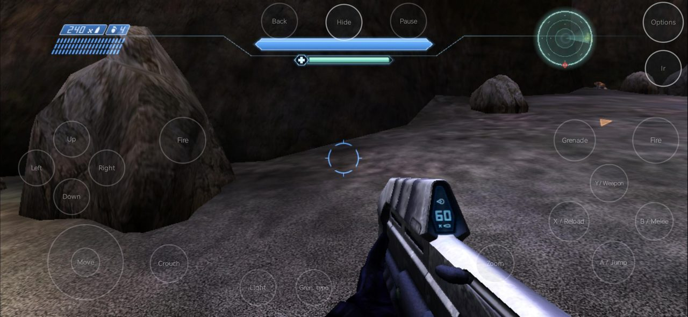
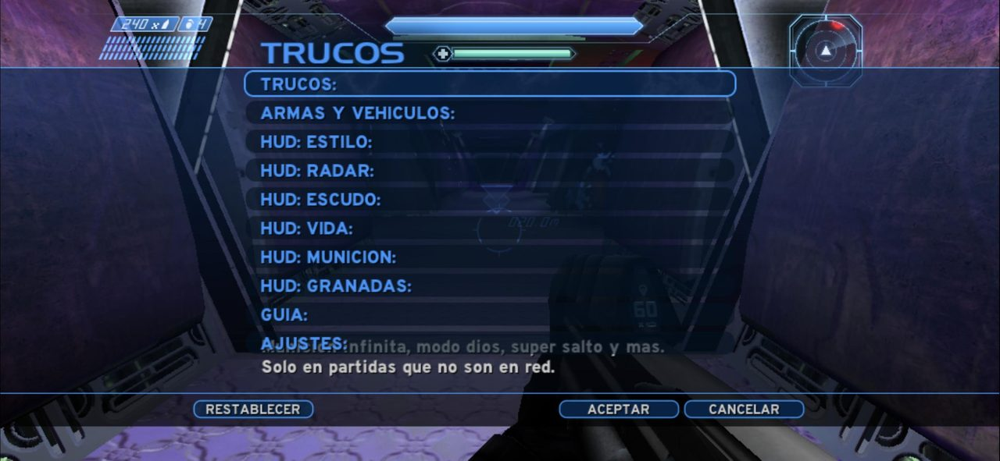
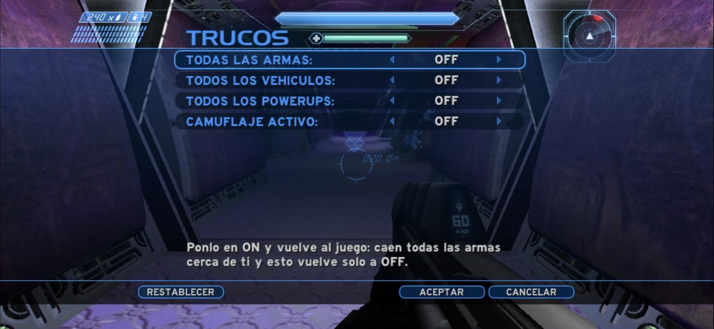
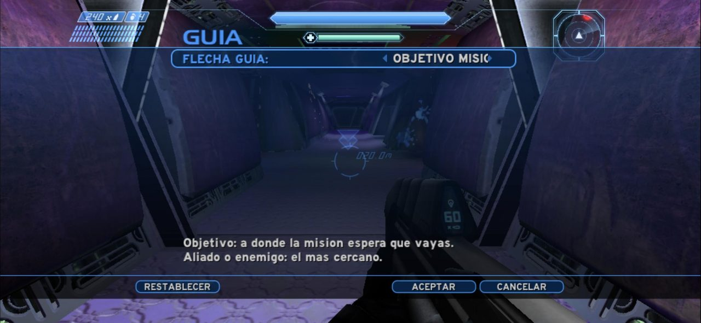
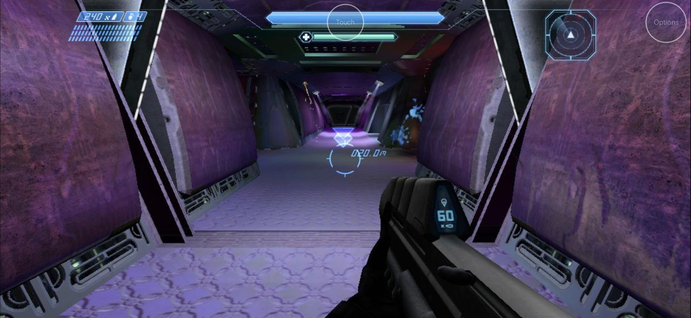
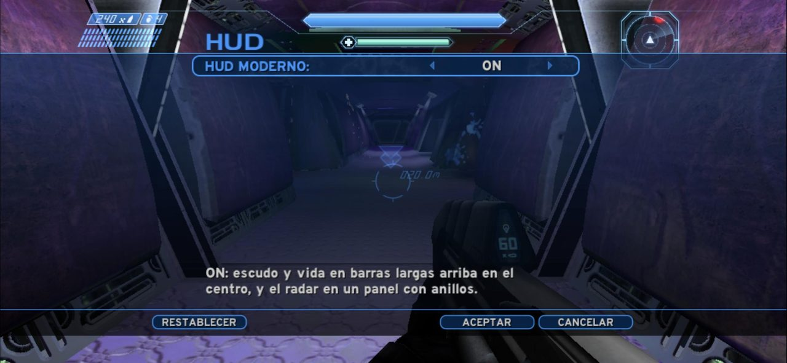
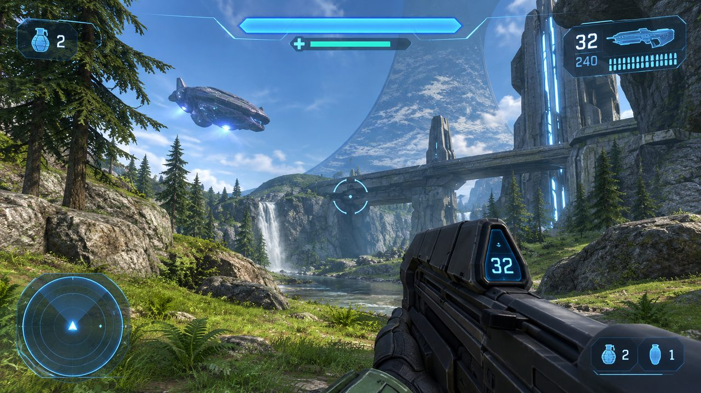
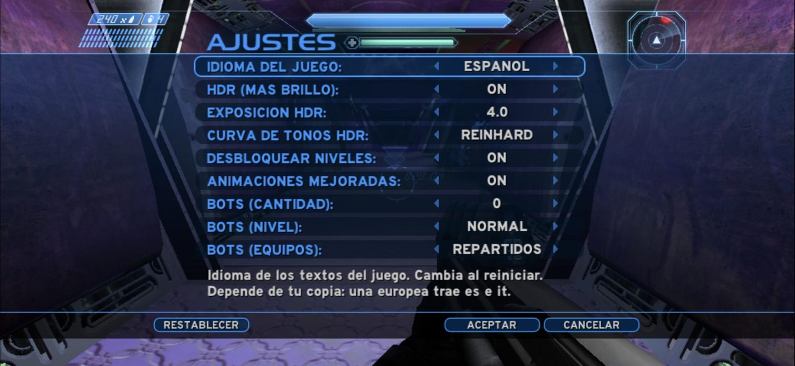

# Halo C.E Android Trucos Mods (OpenCE)

Versión de **Halo: Combat Evolved para Android** basada en [OpenCE (Open Community Edition)](https://github.com/OpenCommunityEdition/OpenCE), con **menús en español**, un **menú de trucos**, una **flecha guía hacia el objetivo de la misión** y la posibilidad de **mover las partes del HUD**.

Este parche de trucos se creó y se aplica sobre el repositorio oficial de OpenCE: hice un parche con los cambios y un workflow de GitHub Actions que se los aplica al código oficial de OpenCE y compila el APK.

**Creador: freddVelp ([@freedsny](https://github.com/freedsny)).**

> Proyecto no oficial de un aficionado. No tiene relación con Microsoft, Xbox Game Studios, Halo Studios, Activision ni Bungie. Halo y Halo: Combat Evolved son marcas de Microsoft Corporation. **No incluye el juego**: necesitas tu propia copia (imagen de disco de Xbox, `.iso` o `.xiso`), como pide OpenCE.

## Qué incluye

### Menús en español
El menú principal (CAMPAÑA, MULTIJUGADOR, PERFILES, AJUSTES, SALIR), los ajustes del perfil, la selección de perfil, el menú de campaña, el de multijugador y los botones (VOLVER, ACEPTAR, CANCELAR...) están en español. Algunas pantallas internas de OpenCE siguen en inglés.

### Menú TRUCOS
Se abre en **AJUSTES > tu perfil > TRUCOS**, y en partida en **pausa > AJUSTES > TRUCOS**.

| Opción | Qué hace |
|---|---|
| Munición infinita | La munición de reserva nunca se acaba |
| Sin recargar | El cargador nunca se vacía |
| Súper salto | Saltas mucho más alto |
| Modo dios | No mueres por disparos ni caídas |
| Matar de un golpe | Tus disparos matan al instante |
| Medusa | Los enemigos que te miran mueren |
| Jetpack | Puedes volar |
| Poseer al chocar | Al chocar con un enemigo o vehículo lo controlas |
| Sentir el daño de otros | Cuando otros reciben daño, tu pantalla reacciona como si te golpearan |

En **TRUCOS > ARMAS, LINTERNA Y MAS**:

| Opción | Qué hace |
|---|---|
| Todas las armas | Caen todas las armas cerca de ti |
| Todos los vehículos | Caen en círculo alrededor de ti, separados |
| Un arma | Eliges una (pistola, rifle de asalto, escopeta, francotirador, lanzacohetes, lanzallamas, pistola o rifle de plasma, needler, cañón de combustible, espada de energía) y cae cerca de ti. **SIGUIENTE DEL MAPA** saca, una por cada uso, todas las armas que el mapa tenga guardadas, con su nombre en pantalla |
| Un vehículo | Eliges uno (Warthog, Warthog de cohetes, Scorpion, Ghost, Banshee, torreta, Wraith, Pelican) y aparece frente a ti. **SIGUIENTE DEL MAPA** saca, uno por cada uso, todos los vehículos que el mapa tenga guardados (no todos se pueden manejar) |
| Todos los powerups | Caen todos los powerups cerca de ti |
| Camuflaje activo | ON: eres invisible (vuelve aunque mueras). OFF: vuelves a ser visible |
| Luz infinita | La linterna nunca se apaga: su batería siempre está llena |
| Linterna amplia | La linterna alumbra 1,7 veces más lejos y con un cono más ancho |
| Teletransporte | Aparece un botón **Ir** debajo de Options: al tocarlo te lleva a donde apunta la flecha guía (necesita la flecha guía encendida). Si no cabes justo ahí, busca un sitio libre alrededor (hasta 10 m); si no hay ninguno, no te mueve. El botón no sale cuando el objetivo está en otra parte del mapa que aún no se ha cargado |

Armas, vehículos y powerups funcionan como **botones**: las pones en ON (o eliges el arma o el vehículo), vuelves al juego, se ejecutan una vez y vuelven solas a OFF (o a NINGUNA). Solo aparecen las armas, vehículos y powerups que el mapa actual tiene cargados: cada misión trae solo los suyos, así que no se puede sacar un Scorpion en una misión que no lo tiene (sale un aviso "no está en este mapa").
Los trucos **solo funcionan en partidas que no son en red**. En el juego de otro jugador valen sus reglas.

### Flecha guía
Una **flecha naranja con la distancia en metros** que te indica hacia dónde ir. Se dibuja igual que los marcadores que el propio juego pone en algunas misiones: una flecha sobre el lugar y los metros debajo. Es naranja para que no se confunda con los niveles que tienen mucho azul. Si lo que busca queda detrás de ti o fuera de la pantalla, la flecha se pega al borde de la pantalla del lado por donde tienes que girar.

#### Cómo activarla
**Pausa > AJUSTES > TRUCOS > GUIA > FLECHA GUIA** (también desde **AJUSTES > tu perfil > TRUCOS > GUIA**). Tiene cuatro opciones:

| Opción | A dónde apunta |
|---|---|
| **APAGADA** | No se muestra (así viene) |
| **OBJETIVO MISION** | Al lugar al que la misión espera que llegues para avanzar |
| **ALIADO CERCANO** | Al aliado vivo más cercano (marines y demás compañeros) |
| **ENEMIGO CERCANO** | Al enemigo vivo más cercano |

El cambio se ve al volver al juego, sin reiniciar. La elección se guarda.

#### Objetivo de la misión
- En la campaña, cada misión tiene zonas invisibles que hacen avanzar la historia cuando entras en ellas (abrir una puerta, que llegue un Pelican, la siguiente escena). La flecha **lee en vivo qué zona está esperando la misión** y apunta a ella.
- Cambia sola cuando avanzas o cambia el objetivo, y funciona también al **cargar una partida guardada** o al empezar desde un punto de control.
- Está preparada para las **diez misiones**: The Pillar of Autumn, Halo, The Truth and Reconciliation, The Silent Cartographer, Assault on the Control Room, 343 Guilty Spark, The Library, Two Betrayals, Keyes y The Maw.
- Si en un momento la misión **no espera que llegues a ningún lugar** (por ejemplo, mientras tienes que eliminar a todos los enemigos de una zona, defender un punto o esperar una escena), **la flecha no aparece**. Vuelve sola cuando la misión vuelve a esperar que camines a algún sitio.
- Fuera de la campaña (multijugador, mapas sin misión) esta opción no muestra nada.

#### Aliado y enemigo cercano
- **Aliado**: cualquier personaje vivo que no sea tu enemigo. No apunta a los que ya tienes al lado (a menos de unos 12 metros), para que te lleve con el resto del grupo.
- **Enemigo**: el enemigo vivo más cercano, esté donde esté. Sirve para encontrar al último Covenant que te falta para que la misión avance.
- "Más cercano" es en línea recta: puede ser alguien al otro lado de una pared. La flecha te lleva por el camino para llegar a él (ver abajo).

#### Funciona como un GPS
La flecha **no apunta a través de las paredes**: te lleva por donde se puede caminar, a cualquier distancia.

- **El mapa de distancias.** Cada vez que la flecha tiene un objetivo nuevo, el juego recorre una sola vez todo el piso de la parte del nivel que está cargada, empezando en el objetivo y extendiéndose hacia afuera, y anota en cada pedazo de piso cuántos metros faltan caminando y cuál es el siguiente pedazo hacia el objetivo. Cuenta el piso por donde caminan los marines y los Covenant, y también lo que solo tú puedes pasar: pendientes empinadas (hasta unos 60°), escalones y taludes que subes de un salto (hasta 1,5 m) o bajas (hasta 6 m). Los acantilados de verdad cuentan como paredes.
- **El tramo corto.** Desde donde estás, la flecha sigue ese mapa unos 24 m hacia el objetivo, y el buscador de caminos de la IA calcula el tramo hasta ahí esquivando columnas y bordes. La flecha apunta a la **siguiente esquina, puerta o rampa** de ese tramo; cuando la pasas (o vas más cerca de la siguiente), salta a la siguiente.
- **Sin trabas.** El mapa se arma en segundo plano, unos 1.500 pedazos de piso por tick y como mucho 3 milisegundos, así que tarda menos de un segundo y el juego no se pone lento. Mientras se arma, la flecha usa el buscador de la IA solo.

Lo que ves:

- **Los metros** son la distancia **caminando** hasta el objetivo final cuando el mapa la conoce (si no, en línea recta), no hasta la esquina a la que apunta la flecha.
- **Flecha doble (⌄⌄)**: es el GPS, el camino a seguir. En una curva puede quedar a un lado: apunta a la curva, no al destino.
- **Rombo (◆)**: no hay camino que calcular y apunta en **línea recta** al objetivo. Te acerca igual, pero puede apuntar a una pared o a una puerta.
- El camino se recalcula unas tres veces por segundo (el doble en un vehículo), y antes si el objetivo se mueve (un aliado o enemigo que camina).

#### Cuándo sale el rombo
- **El objetivo está en otra parte del mapa que todavía no está cargada.** Los mapas se cargan por partes: estando dentro de un edificio, el exterior no está cargado, y al revés (por ejemplo, en The Silent Cartographer). En cuanto cruzas a esa parte, la flecha vuelve a ser GPS.
- **Vas en un ascensor o una plataforma que se mueve**, o el objetivo está arriba o abajo de uno, o en el aire: el GPS no sabe usar ascensores (pasa mucho en The Library).
- **Una puerta que la misión abre más tarde**: el camino pasa por ella, y hay que esperar o hacer lo que pide la misión.

#### Consejos
- Si la flecha parece rara, camina unos pasos: se recalcula enseguida.
- Probado en Halo (con el Warthog), 343 Guilty Spark, The Library y The Silent Cartographer.
- La flecha es solo una ayuda visual: no cambia la misión ni hace trampa con los enemigos.

### HUD movible
La forma más fácil es **con el dedo**: en partida toca **Options > Edit buttons layout**. Sobre el escudo, la vida, el radar, la munición y las granadas aparecen cuadros azules, cada uno con una pestaña con su nombre. Arrastra la pestaña (o el cuadro) y la parte del HUD se mueve en vivo; al pulsar **Save** queda guardada.

También se puede ajustar con números en **TRUCOS > HUD**, que tiene una pantalla para cada parte. Cada una se mueve en horizontal y vertical con un ajuste **grueso** (de 100 en 100, hasta ±1000) y uno **fino** (de 5 en 5, se suma al grueso): por ejemplo, 625 es 600 y +25. Un número positivo mueve a la derecha o hacia abajo; 0 deja cada parte donde el juego la pone. Lo que mueves con el dedo aparece ahí también. La mira no se puede mover.

### HUD moderno (opcional)
En **TRUCOS > HUD: ESTILO > HUD MODERNO: ON** el HUD cambia a un estilo como el de los Halo recientes:

- **Escudo**: una barra larga arriba en el centro, de una sola pieza con puntas, en relieve (más clara arriba, más oscura abajo) y con brillo. Se vacía de derecha a izquierda, parpadea cuando está casi vacío y se pone dorado con el sobreescudo.
- **Vida**: debajo, el "+" en su propia figura y al lado una barra verde agua; se pone roja cuando estás bajo de vida.
- **Líneas de visor**: salen de los lados, bajan en diagonal y pasan por debajo del escudo.
- **Radar**: en un panel de ocho lados con anillos, cruz, marcas y la flecha del jugador.

La munición y las granadas siguen siendo las del juego. Las partes nuevas también se mueven con el dedo en el editor de botones.

Es una **modificación opcional**: puedes dejar el **HUD original** del juego (OFF, como viene) o usar el **moderno** (ON), y cambiar entre los dos cuando quieras.

El estilo se basó en esta **imagen de referencia**. Es una ilustración, no una captura del juego: el paisaje y la munición/granadas de la imagen no son parte de esta versión, solo la idea del escudo, la vida y el radar.

### Radar con barrido
El radar tiene encima un barrido azul que gira (y, con el HUD original, una cruz y dos anillos). Para quitarlo: **TRUCOS > HUD: RADAR > RADAR CON BARRIDO: OFF**.

### Ajustes
En **TRUCOS > AJUSTES**:

- **Idioma del juego**: con una copia europea del juego (que trae español), los textos que vienen del disco salen en español. Cambia al reiniciar.
- **HDR, exposición y curva de tonos**: activar HDR y subir la exposición ayuda cuando el juego se ve oscuro; puede bajar la fluidez.
- **Desbloquear niveles** de la campaña (solo para perfiles nuevos).
- **Animaciones mejoradas**.
- **Bots** para partidas locales de Slayer a pantalla dividida: cantidad, nivel y equipos.

### Otros detalles
- La app se llama **Halo C.E**.
- Las versiones se firman siempre con la misma llave, así que cada APK nuevo **se instala encima del anterior sin borrar tu partida**.

## Cómo conseguir el APK

El APK se compila solo con **GitHub Actions** a partir del código oficial de OpenCE, al que se le aplica el parche (`trucos/trucos.patch`).

1. Entra a la pestaña **Releases** (Lanzamientos) de este repositorio.
2. Descarga el APK de la versión más reciente (marcada como "Latest"). Su nombre lleva la versión de OpenCE con la que se compiló y el número de la versión, el mismo del título (#96), por ejemplo `HaloCE-trucos-build-347-n96.apk`.
3. Instálalo en tu celular (puede pedirte permitir instalar apps de fuentes desconocidas).

Para compilar una versión nueva: **Actions > Compilar OpenCE con trucos (APK) > Run workflow**. Por defecto usa la última versión de OpenCE; también puedes escribir una específica, por ejemplo `build-335`.

### Actualización automática
Cada día, GitHub revisa si OpenCE publicó una versión nueva (**Actions > Vigilar versiones nuevas de OpenCE**). Si la hay, compila y publica el APK solo, sin que tengas que hacer nada.

Si una compilación falla (por ejemplo, porque una versión nueva de OpenCE cambió algo que toca el parche), se abre un aviso en **Issues** con el enlace al error. Mientras ese aviso esté abierto, no se vuelve a intentar sola; se cierra cuando el parche quede arreglado.

### Versiones de prueba
Los cambios nuevos se prueban primero en la rama **`pruebas`**. Lo que se compila desde ahí es **privado**: sale en **Releases** como **borrador (Draft)**, que solo ve el dueño del repositorio, y es **otra app** ("Halo PRUEBA", paquete `com.halo.decomp.pruebas`) que se instala al lado de la normal sin reemplazarla. Tiene su propia carpeta para los archivos del juego y las partidas. Cuando la prueba sale bien, el cambio pasa a la rama `main`.

## Cómo está hecho este repositorio

Este repositorio **no es un fork** del código de OpenCE: solo guarda los cambios.

| Archivo | Para qué sirve |
|---|---|
| `.github/workflows/build-android.yml` | Descarga OpenCE, aplica los trucos, compila y publica el APK |
| `.github/workflows/vigilar-opence.yml` | Revisa cada día si hay una versión nueva de OpenCE y la compila |
| `trucos/trucos.patch` | Los cambios al código de OpenCE: trucos, flecha guía, HUD y menús |
| `trucos/regenerar_menus.py` | Genera las pantallas del menú, las registra y las pasa al español |
| `trucos/textos_es.py` | Los textos en español de los menús |
| `trucos/menu_es.py` | Dibuja en español las palabras del menú principal y los títulos |
| `trucos/header_*.png` | Los títulos TRUCOS, HUD, AJUSTES y GUIA |
| `capturas/` | Las capturas de este README |
| `LICENSE` | La licencia GNU AGPL v3, la misma de OpenCE |

Si OpenCE cambia las partes que toca el parche, la compilación puede fallar en el paso "Aplicar los trucos" y habrá que ajustar el parche.

## Créditos y licencia

- **OpenCE** y todo el código del juego: [OpenCommunityEdition/OpenCE](https://github.com/OpenCommunityEdition/OpenCE), bajo la licencia **GNU AGPL v3**. Los cambios de este repositorio se comparten bajo esa misma licencia (ver [LICENSE](LICENSE)).
- Trucos y menús en español, flecha guía, HUD movible y compilación automática: **freddVelp** ([@freedsny](https://github.com/freedsny)).
- La flecha de objetivo usa solo los nombres de los scripts de cada misión como referencia; no incluye scripts ni datos del juego.
- Halo: Combat Evolved © Microsoft Corporation.
